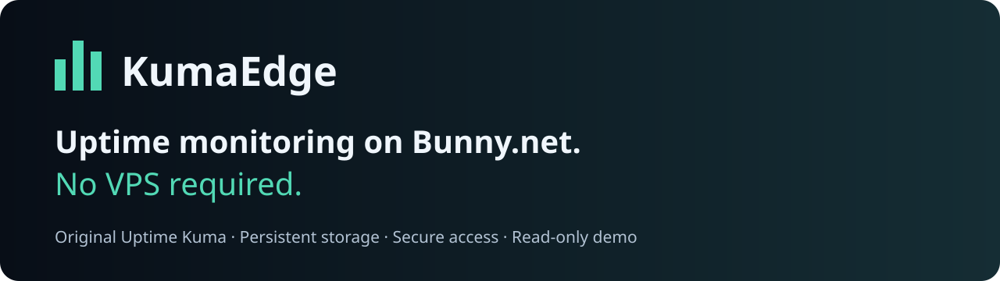
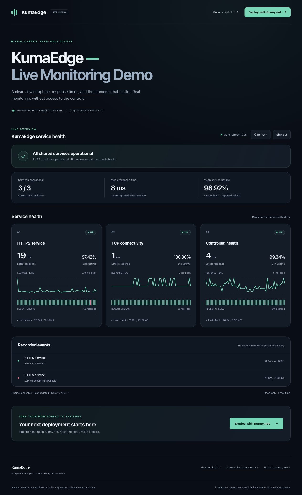
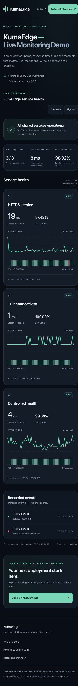
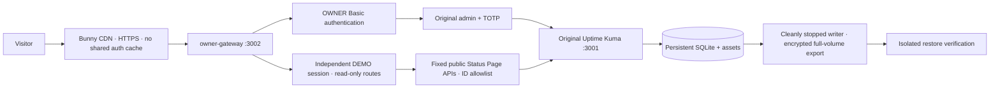
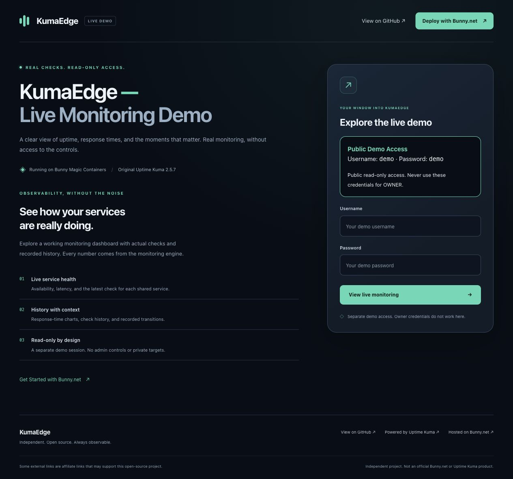
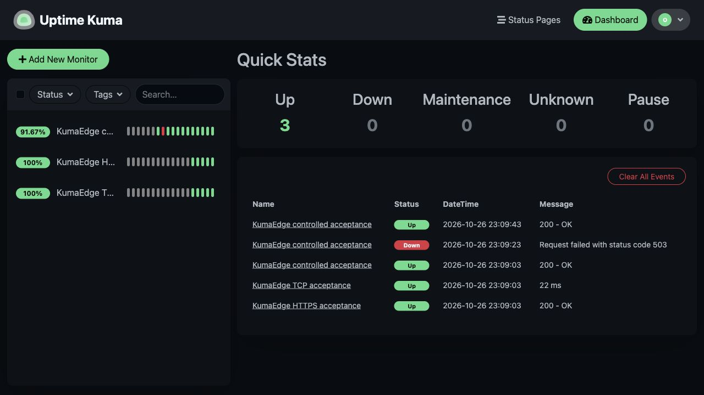
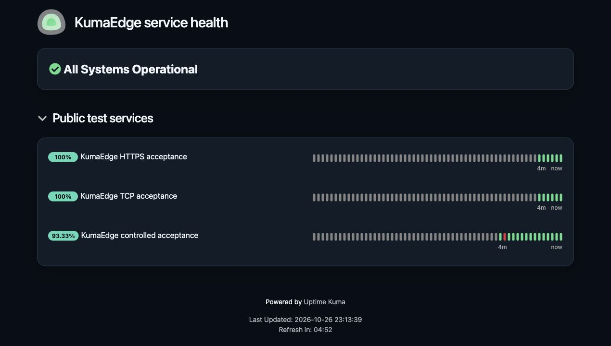

<p align="center"></p>



<h1 align="center">Uptime monitoring. Without the VPS.</h1>

<p align="center">Deploy the original Uptime Kuma on Bunny Magic Containers with persistent storage,<br>secure access, encrypted recovery tooling and a beautiful read-only demo.</p>

<p align="center">


</p>

<!-- demo-showcase:start -->
<p align="center"><a href="https://mc-b4n2u1709h.bunny.run/demo" target="_blank" rel="noopener noreferrer sponsored"><strong>Live Demo ↗</strong></a> &nbsp; · &nbsp; <a href="#quick-start"><strong>Quick Start</strong></a> &nbsp; · &nbsp; <a href="https://bunny.net?ref=4mvi9kc9vn" target="_blank" rel="noopener noreferrer sponsored"><strong>Deploy on Bunny.net ↗</strong></a> &nbsp; · &nbsp; <a href="docs/README.md"><strong>Documentation</strong></a></p>

<p align="center"><em>Deploy on Bunny.net is an affiliate link. Some external links are affiliate links that may support this open-source project.</em></p>

## See real monitoring in action



<p align="center"></p>

### Try the Live Demo

| | Public access |
|---|---|
| URL | https://mc-b4n2u1709h.bunny.run/demo |
| Username | `demo` |
| Password | `demo` |
| Access | **Read-only** |

No invitation or individual password request. The public demo cannot edit monitors, manage notifications or access private targets, OWNER APIs, admin sessions, keys or SQLite. Every metric comes from actual recorded checks; screenshots are not an availability guarantee.

<a href="https://bunny.net?ref=4mvi9kc9vn" target="_blank" rel="noopener noreferrer sponsored"><strong>Hosted on Bunny.net ↗</strong></a> · <a href="https://github.com/aitishnyk/KumaEdge" target="_blank" rel="noopener noreferrer sponsored"><strong>View on GitHub ↗</strong></a> · <a href="https://github.com/louislam/uptime-kuma" target="_blank" rel="noopener noreferrer sponsored"><strong>Powered by Uptime Kuma ↗</strong></a>
<!-- demo-showcase:end -->

## Why KumaEdge?

**Uptime Kuma is the monitoring engine. KumaEdge is the deployment and access layer.** Keep the familiar upstream dashboard, checks and Status Pages while moving compute and persistent storage to Bunny Magic Containers. Manage one application rather than a VPS operating system.

The original engine provides monitoring, history, incidents and notification integrations. KumaEdge adds a protected gateway, an independently authenticated read-only showcase, local release verification, Terraform and encrypted recovery tooling. It is an independent MIT project, not an official Bunny.net or Uptime Kuma product.

## What you get

| Capability | What it means |
|---|---|
| Original engine | Uptime Kuma **2.5.7**, with HTTP/HTTPS/TCP and other upstream check types |
| Useful history | Actual uptime, response measurements, recorded transitions and upstream Status Pages |
| Notifications | Upstream integrations when configured; external delivery must be tested by the operator |
| Layered access | OWNER gateway authentication plus a separate original Kuma admin and TOTP |
| Public showcase | Read-only DEMO routes with explicit public-service allowlists and bounded sessions |
| Persistent data | SQLite on one durable volume; exactly one engine writer |
| Recovery | Full-volume encrypted export and isolated restore verification tooling |
| Repeatable releases | Local Mac + Docker tests, immutable OCI digest evidence and reviewed Terraform updates |
| Small footprint | One app, two containers, one region, one replica, one volume, one Pull Zone |

## Architecture



DEMO is a gateway view of the **same engine**, not a second Uptime Kuma runtime. DEMO cookies never authenticate OWNER API or administrative Socket.IO. The engine has no public endpoint. One region and one replica protect the SQLite single-writer contract; this is not high availability or zero-cost serverless.

## Quick Start

### A. Try the demo

Open [Live Demo](https://mc-b4n2u1709h.bunny.run/demo), use `demo` / `demo`, and explore the real service metrics. No invitation required. This public login grants no administrative rights.

### B. Deploy your own

Bring a paid Bunny account, local Docker Desktop, Node.js 22+, Python 3, Terraform and age. Start in a fresh clone with **your own account and state**:

```bash
git clone https://github.com/aitishnyk/KumaEdge.git
cd KumaEdge
npm test
python3 -m unittest discover -s test/python -v
terraform -chdir=infra/bunny init -backend=false
terraform -chdir=infra/bunny validate
```

Then follow the exact [Installation guide](docs/INSTALLATION.md): choose verified SHA/digest evidence, prepare registry pull and independent private credentials, run `bash scripts/install-bunny.sh`, review the complete paid Terraform plan, and explicitly approve creation. Harden the generated HTTPS/CDN endpoint, initialize the original owner in the protected UI, enroll TOTP, add monitors and test encrypted backups.

Bunny Magic Containers are continuously running **paid resources**. Cost depends on consumed CPU/RAM, disk and traffic; there is no spending cap in this tooling. Do not run new-install apply against the reference app or another existing state. No additional Bunny resources are created by trying the public demo.

## Design & Customization

The original **Obsidian Cloud** design uses deep navy surfaces and mint service signals. The interfaces are intentionally separate:

| Interface | Source / customization |
|---|---|
| DEMO styles | [`scripts/demo-assets/demo.css`](scripts/demo-assets/demo.css) |
| DEMO data and charts | [`scripts/demo-assets/demo.js`](scripts/demo-assets/demo.js) |
| DEMO templates and access boundary | [`scripts/demo-mode.cjs`](scripts/demo-mode.cjs) |
| Standard Status Page theme | [`examples/status-page/obsidian-cloud.css`](examples/status-page/obsidian-cloud.css) |
| Apply the theme | [How to Apply the Obsidian Cloud Theme](docs/CUSTOM_CSS.md#how-to-apply-the-obsidian-cloud-theme) |
| Original logos and social preview | [Branding assets and attribution](docs/BRANDING.md) |

Changing `/demo` CSS does not automatically change `/status/<slug>`. The Status Page theme is applied through the original upstream Custom CSS editor. No external framework or tracking SDK is required.

<details>
<summary><strong>More screenshots: login, original OWNER and themed Status Page</strong></summary>







OWNER and themed Status Page images use a documented disposable local dataset. The live reference Status Page remains unchanged. No metrics are drawn or manually edited into screenshots. [Screenshot provenance](docs/BRANDING.md).

</details>

## Documentation

[Installation](docs/INSTALLATION.md) · [Docker Development](docs/DOCKER_DEVELOPMENT.md) · [Bunny Terraform](docs/BUNNY_TERRAFORM.md) · [Configuration](docs/CONFIGURATION.md) · [Enabling Demo Mode](docs/DEMO_CONFIGURATION.md) · [Custom CSS](docs/CUSTOM_CSS.md) · [Security](docs/DEMO_SECURITY.md) · [Backups](docs/FULL_VOLUME_BACKUP.md) · [Restore](docs/RESTORE.md) · [Upgrade](docs/UPGRADE.md) · [Rollback](docs/ROLLBACK.md) · [Troubleshooting](docs/TROUBLESHOOTING.md)

Start at the [documentation index](docs/README.md). Historical release reports remain available as evidence; they are not current installation instructions.

## Limits & operational readiness

The reference deployment is **DEMO_READY**, not PRODUCTION_READY. No external notification channel has been certified. A local isolated restore has been verified; Bunny-to-Bunny recovery is not certified. Operators must validate their own alert delivery, retention, paid usage and recovery objectives. One region/replica is a deliberate availability tradeoff. A public `demo/demo` identity is convenient access, not a secret or a security boundary; the gateway's read-only allowlist is the boundary.

## Open source, support & attribution

- **License:** [MIT](LICENSE). Original engine: [Uptime Kuma by Louis Lam and contributors](https://github.com/louislam/uptime-kuma). Retain upstream notices.
- **Contributing:** [local development and contribution guide](CONTRIBUTING.md).
- **Security:** report sensitive issues using [Security Policy](SECURITY.md); never publish credentials, state, cookies or backups.
- **Support:** [open an issue](https://github.com/aitishnyk/KumaEdge/issues) with sanitized reproduction steps. Community project; no commercial support SLA.
- **Releases:** [GitHub releases](https://github.com/aitishnyk/KumaEdge/releases) and [retained release evidence](docs/releases/).
