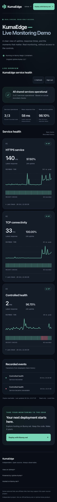

# KumaEdge

**Original Uptime Kuma. An independent read-only showcase. Hosted on Bunny Magic Containers.**

KumaEdge is an MIT-licensed deployment project for original **Uptime Kuma 2.5.7**,
with a separate OWNER gateway and a server-enforced DEMO experience. The monitoring
engine keeps its original dashboard, notifications, status pages, history and TOTP.

<!-- demo-showcase:start -->
## See KumaEdge in action

<a href="https://mc-b4n2u1709h.bunny.run/demo" target="_blank" rel="noopener noreferrer sponsored"><strong>Live Demo ↗</strong></a> &nbsp; · &nbsp; <a href="https://bunny.net?ref=4mvi9kc9vn" target="_blank" rel="noopener noreferrer sponsored"><strong>Deploy with Bunny.net ↗</strong></a> *(affiliate link)*

Real availability, response-time charts, recent check history and recorded events,
in a responsive, read-only interface. Hosted on Bunny Magic Containers, powered by
original [Uptime Kuma](https://github.com/louislam/uptime-kuma) 2.5.7. No fabricated monitoring results.

**Demo access:** open **Live Demo**, sign in as `demo` with the separate demo password
shared by the project maintainer. OWNER gateway and Kuma admin credentials do not
work for DEMO and must never be published. The demo cannot edit monitors or access
private targets, settings, keys or SQLite. The screenshot shows a real disposable
local acceptance dataset, not a production availability guarantee.

<a href="https://bunny.net?ref=4mvi9kc9vn" target="_blank" rel="noopener noreferrer sponsored"><strong>Hosted on Bunny.net ↗</strong></a> · <a href="https://github.com/aitishnyk/KumaEdge" target="_blank" rel="noopener noreferrer sponsored"><strong>View on GitHub ↗</strong></a>

*Some external links are affiliate links that may support this open-source project.* KumaEdge is an independent MIT-licensed open-source project,
not an official product of Bunny.net or Uptime Kuma.
<!-- demo-showcase:end -->

## Architecture

| Access | Purpose |
|---|---|
| OWNER gateway | Private outer authentication before the original Kuma interface |
| Kuma admin + TOTP | Original administration of monitors, settings and notifications |
| DEMO | Separate login/session; only explicitly public service labels and recorded metrics |

The existing reference deployment uses one Bunny app, two containers (Kuma and
owner-gateway), one DE replica, one 5GB SQLite volume, one CDN Pull Zone and one
HTTPS hostname. DEMO runs inside the existing gateway. The standard original
status page remains unchanged. There is no third demo container or second engine.

## Installation and operation

- [Bunny Terraform installation](docs/BUNNY_TERRAFORM.md) · [manual setup](docs/BUNNY_MANAGED.md)
- [Local Mac Docker release](docs/LOCAL_DOCKER_RELEASE.md) · [DEMO configuration](docs/DEMO_CONFIGURATION.md)
- [DEMO security boundaries](docs/DEMO_SECURITY.md) · [credentials policy](docs/BUNNY_LOCAL_CREDENTIALS.md)
- [Encrypted full-volume backup and restore](docs/FULL_VOLUME_BACKUP.md)
- [v0.20.0 accepted baseline and rollback](docs/V020_RELEASE_AND_ROLLBACK.md)
- [Latest live acceptance report](docs/BUNNY_LIVE_ACCEPTANCE_REPORT.md)

Build, test and publish locally on the trusted Mac; **no GitHub Actions**. Keep
persistent Terraform state and infrastructure secrets private. New paid installs
and existing-app updates require a reviewed plan and explicit local approval.
Never rerun a new-install script against an existing app or replace a live volume.

The optional backup image is a paired release artifact; it is not deployed as a
third container in the reference deployment. Full actual Bunny-source encrypted
backup and independent isolated local restore are available through the existing
owner+capability operations path. Recovery identity remains outside Bunny.

## Verification and readiness

The accepted v0.20.0 baseline is **DEMO_READY**. OWNER/TOTP, separate DEMO, HTTPS,
WebSocket/CDN, monitoring, same-volume restart and real Bunny backup/local restore
passed. External notification delivery remains NOT_VERIFIED because no channel is
configured; no PRODUCTION_READY claim is made. Consult the live report for the
exact immutable runtime SHA, OCI digests and v0.20.1 deployment status.

## Contributing

[Source code](https://github.com/aitishnyk/KumaEdge) · [Contributing](CONTRIBUTING.md) ·
[Security](SECURITY.md) · [MIT License](LICENSE)

The historical Edge Preview track offers manual checks only; it is not the
persistent monitoring engine or the integrated DEMO shown above.
